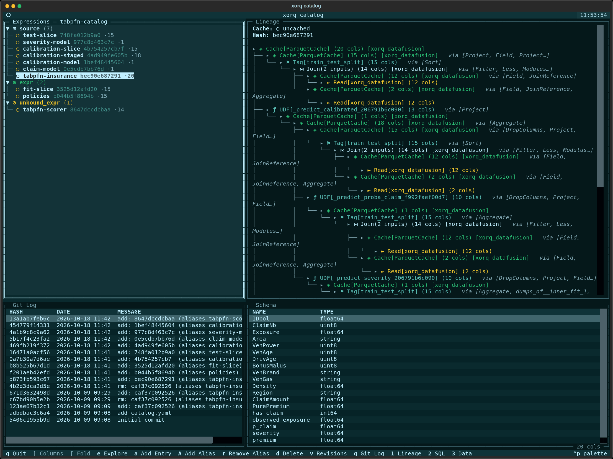
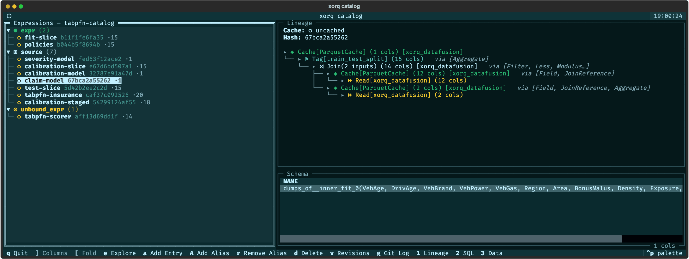

<div align="center">


[Documentation](https://docs.xorq.dev) • [Website](https://www.xorq.dev)
</div>

---

Xorq is three interlinked things, plus the interfaces built on them.

1. **An IR.** An agent-native intermediate representation for cross-engine,
   composable, cacheable, declarative execution. A pipeline is an Ibis
   expression that compiles to many engines, caches at any node, and composes
   with other expressions.
2. **A ledger.** The IR makes every pipeline a durable artifact that is
   cheap to verify: one computation, defined before it runs, named by a hash
   of its definition, with human-interpretable lineage alongside. The ledger
   steers agent work. An agent selects a reviewed entry instead of
   re-deriving it from source files.
3. **A CLI.** It governs execution against the ledger: build, add, run,
   check, pin, rebase, compose. Arbitrary compute enters the deterministic
   system the ledger builds through UDXFs, Python functions that exchange
   Arrow tables over Flight.

Interfaces on top serve different kinds of users. The CLI doubles as the
headless mode for agents and the TUI is the view for humans, both in this repo. A desktop
app and a sub-agent verifier mode use the same three layers.

Below, the ten-entry ledger of an insurance pricing pipeline from
[A Commit vs. a Ledger Entry](https://xorq.dev/blog/commit-vs-ledger-entry/).
The selected entry is the scored test set: its lineage runs through three
fitted models down to the two source reads, next to its schema and a git log
with one commit per entry.



A fitted model is an entry too. The classifier below is a one-column table
named after the features and target it was fit on, with its training slice as
its lineage.



## Why a ledger steers agents

On [DABStep](https://huggingface.co/spaces/adyen/DABstep), 450 data-analysis
questions over payment transaction data, a Xorq ledger of 33 named
expressions takes Haiku from 50% to 84%, 9 points above the Sonnet baseline
([Orientation Over Reasoning](https://xorq.dev/blog/orientation-over-reasoning/)).


One metric question, run 900 times with Haiku
([Faithful, Reproducible, Wrong](https://xorq.dev/blog/faithful-reproducible-wrong/)).
Where the agent looked for the definition mattered more than which model it
used:

| | Derived from source files | Selected from a reviewed entry |
|---|---|---|
| Correct | 0 of 100 | 100 of 100 |
| Median turns | 21 | 4 |
| Cost per run | $0.09 | $0.02 |

## Getting started

```bash
❯ pip install "xorq[examples]"
❯ xorq init -t penguins && cd xorq-template
❯ xorq uv build expr.py
builds/4c915297a711
❯ xorq catalog init
Initialized catalog at ~/.local/share/xorq/catalogs/default
❯ xorq catalog add builds/4c915297a711/ -a penguins-predict
Added 4c915297a711
❯ xorq uv run builds/4c915297a711 -o out.parquet
```

Build turns an expression into a directory named by its hash, holding the
manifest, the project wheel, and pinned requirements. Add puts that directory
in the ledger under its hash and an alias. Run executes it in the environment
the entry pins.

## The IR

Xorq extends [Ibis](https://ibis-project.org/) with caching, multi-engine
execution, and UDFs. `xo._` is the Ibis row reference, so `xo._.species` is
the `species` column of the current table.

```python
import xorq.api as xo

penguins = xo.examples.penguins.fetch()
expr = (
    penguins
    .filter(xo._.species.notnull())
    .group_by("species")
    .agg(avg_bill_length=xo._.bill_length_mm.mean())
)
```

`.cache(ParquetCache.from_kwargs())` materializes any node.
`.into_backend(con)` moves its data to another engine. The same expression
runs on DataFusion, DuckDB, SQLite, pandas, Snowflake, Databricks, BigQuery,
Trino, Postgres, PyIceberg, and GizmoSQL. Operators exchange Arrow
RecordBatches, with no DAG of tasks to checkpoint. `Pipeline.from_instance`
turns a scikit-learn pipeline into a deferred expression.

## The ledger

The ledger is a git repo on the filesystem. Aliases are symlinks, entries are
zipped builds, and metadata sidecars are plain YAML, so an agent that clones
it can discover everything with file operations:

```
❯ tree git-catalogs/penguins
git-catalogs/penguins
├── aliases
│   └── penguins-agg.zip -> ../entries/b45d9db8189a.zip
├── catalog.yaml
├── entries
│   └── b45d9db8189a.zip
└── metadata
    └── b45d9db8189a.zip.metadata.yaml

❯ git -C git-catalogs/penguins reflog
81a694a HEAD@{0}: add: b45d9db8189a (aliases penguins-agg)
e00f12c HEAD@{1}: add catalog.yaml
```

An entry is a manifest plus the environment to run it. The manifest is the
content-addressed specification of the pipeline: one node per operation, each
referenced by hash, with schema, lineage, and inputs read straight off it.
The wheel and pinned `requirements.txt` next to it make the entry portable to
another sandbox, your machine, or production.

<details>
<summary>Abridged <code>expr.yaml</code> for the expression above</summary>

```yaml
definitions:
  nodes:
    '@read_dbd8d81198f1':
      op: Read
      method_name: read_parquet
      name: penguins
      schema_ref: schema_11039d461f5b

    '@filter_f7eedc0c6f85':
      op: Filter
      parent: { node_ref: '@read_dbd8d81198f1' }
      predicates:
        - { op: NotNull, arg: { op: Field, name: species, ... } }

    '@aggregate_b45d9db8189a':
      op: Aggregate
      parent: { node_ref: '@filter_f7eedc0c6f85' }
      by:
        species: { op: Field, name: species, ... }
      metrics:
        avg_bill_length: { op: Mean, arg: { op: Field, name: bill_length_mm, ... } }

expression:
  node_ref: '@aggregate_b45d9db8189a'
  schema_ref: { schema_ref: schema_cdf21e46eb8a }
```

</details>

Governance catalogs (Atlan, Collibra, Unity Catalog) inventory the tables you
already have. The ledger catalogs the computation, so an entry is something
you run, not something you read about. Xorq reads governed tables through the
Snowflake and Databricks backends, and its entries can be registered there as
assets.

## The CLI

Every verb takes an entry or alias. The ones that produce a pipeline (pin,
rebase, compose) write it back as a new entry. Nothing is edited in place.

```bash
❯ xorq catalog run prod -o out.parquet          # execute in the entry's pinned environment
❯ xorq catalog run-cached prod                  # execute through the entry's caches
❯ xorq catalog check                            # entries, aliases and metadata agree with disk
❯ xorq catalog check-sources prod               # did a source schema drift? reports, never repairs
❯ xorq catalog rebase prod                      # re-derive over live sources as a new entry
❯ xorq catalog pin prod --alias prod-pinned     # freeze the caches as a new entry
❯ xorq catalog compose src transform -a pipeline  # source entry + transform entry, cataloged as one
❯ xorq serve-flight-udxf builds/<hash>          # serve a build's UDXF nodes over Arrow Flight
```

A UDXF is how arbitrary compute joins the system: a Python function that takes
an Arrow table and returns one, run in its own process behind Flight, named
and cataloged like any other node. See
[User-Defined Exchange Functions](https://docs.xorq.dev/api_reference/user_defined_exchange_functions).

## Learn more

- [Quickstart](https://docs.xorq.dev/getting_started/quickstart)
- [Why Xorq?](https://docs.xorq.dev/#why-xorq)
- [Scikit-learn template](https://github.com/xorq-labs/xorq-template-sklearn)
- [xorq-gallery](https://github.com/xorq-labs/xorq-gallery): end-to-end examples
- [Orientation Over Reasoning](https://xorq.dev/blog/orientation-over-reasoning/): Haiku with a Xorq catalog hits 84% on DABStep, above the Sonnet baseline

---

Pre-1.0. Expect breaking changes with migration guides.
