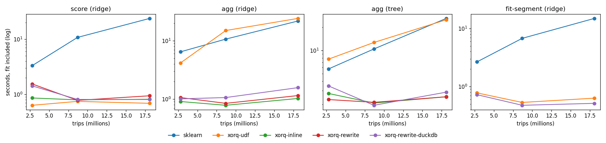

# Native ML rewrites: NYC taxi

Spike. `xorq.expr.ml.native` adds two expression nodes, `Fit` (a reduction
whose value is a fitted sklearn estimator) and `Predict` (a value scoring
rows with it). An `ml` transform pass runs before execution. It fits each
model once and inlines the fitted pipeline as SQL through
[orbital](https://github.com/posit-dev/orbital). It also rewrites `SUM`/`MEAN`
of a linear model's predictions into per-feature aggregates. Set
`xo.options.ml.rewrite = False` to fall back to today's pandas UDF path, or
narrow `xo.options.ml.rules` to switch individual rules off.

```python
from xorq.expr.ml.native.api import explain, fit, fit_by, predict

model = fit(train, features, "fare_amount", pipeline)
scored = trips.mutate(predicted=predict(model, trips))
print(explain(scored))  # the SQL that runs, model inlined
```

## Run

```bash
uv sync --group ml-spike --extra duckdb
python examples/ml_rewrites_taxi/demo.py --months 1   # SQL before/after per query
python examples/ml_rewrites_taxi/bench.py             # 1, 3, 6 months; ~40 min
```

Data: 2024 yellow taxi trips, cached in `~/.cache/xorq-taxi`. Pipeline:
`StandardScaler` on 4 numeric features and `OneHotEncoder` on 2 categorical
ones, then `Ridge` (or `DecisionTreeRegressor(max_depth=8)`), fitted on the
first week of January.

| query | what it asks |
|---|---|
| score | predicted fares for JFK pickups in one week |
| agg | mean predicted fare per pickup zone and hour |
| fit-segment | one model per payment type |

## Results, 6 months (18.1M trips)

Median of 3 runs, each end to end with the fit included. Every run is a
fresh process. `sklearn` pulls the cleaned trips into pandas, then scores
and filters there. `xorq-udf` is rewrites off, which is the current
xorq path.

| query | sklearn | xorq-udf | xorq-inline | xorq-rewrite | xorq-rewrite (DuckDB) |
|---|---|---|---|---|---|
| score (ridge) | 23.9 s | 0.69 s | 0.81 s | 0.94 s | 0.80 s |
| agg (ridge) | 21.8 s | 24.2 s | **1.02 s** | 1.15 s | 1.57 s |
| agg (tree) | 26.1 s | 25.1 s | 2.51 s | 2.50 s | 2.87 s |
| fit-segment | 14.9 s | 0.63 s | n/a | n/a | 0.51 s |
| peak RSS, agg (ridge) | 15.5 GB | 1.4 GB | 1.1 GB | 1.2 GB | 0.8 GB |
| rows scored in Python, agg | 18.1M | 18.1M | 0 | 0 | 0 |

Configs other than the DuckDB column run on datafusion. Full numbers are in
`results/bench.csv`, and `results/bench.png` shows the 1/3/6-month sweep.



## What this shows

- Inlining is where the time goes. Aggregating over every row: 24 s with a
  Python UDF, 1 s as SQL. No row reaches Python, and peak memory drops 14x
  against pulling the data into pandas.
- Filter pushdown came free. The SQL compiler already folds a filter after
  scoring into the scoring `SELECT`'s `WHERE`, so even the UDF path scores
  only the 31k JFK rows. That is why `xorq-udf` wins `score`: it does no
  translation work. Tests pin this behaviour; there is no rule for it.
- Aggregate pushdown is correct but not faster here. Once the model is SQL,
  scoring each row is cheap vectorized arithmetic. Rewriting it into one
  `SUM ... FILTER` per feature costs about the same, and somewhat more on
  DuckDB. The rule only pays off when per-row scoring is expensive.
- Fitting per segment is quick because only the first week's training
  columns are read. The sklearn baseline pays for pulling all six months.

## Accuracy

- Ridge inlined matches sklearn to 1e-13 relative.
- Trees are not exact. ONNX stores split thresholds and leaf values as
  float32, while orbital compares float64 inputs. On January data, 12 of
  4995 zone-hour means differ from sklearn scoring of the same tree, by up
  to 0.27%.
- Tree fits themselves differ between engines. Parquet reads return rows in
  no fixed order, and sklearn breaks split ties by row order. So the tree
  rows in `bench.csv` compare different trees, and their error column is
  not an inlining error.

## Limits of the spike

- Scoring only: Fit/Predict nodes do not round-trip through YAML, build
  hashes or the catalog, and `Pipeline`/`FittedPipeline` do not emit them.
- The pandas UDF fallback, for estimators orbital cannot convert or for
  `predict_proba`, runs on datafusion only. On DuckDB, `make_pandas_udf`
  over several columns fails, and it fails on main too.
- Feature columns must be plain columns, not KV-encoded. `fit_by` groups
  by column names.
- Rewrites are single-engine; nothing is pushed across `into_backend`.
